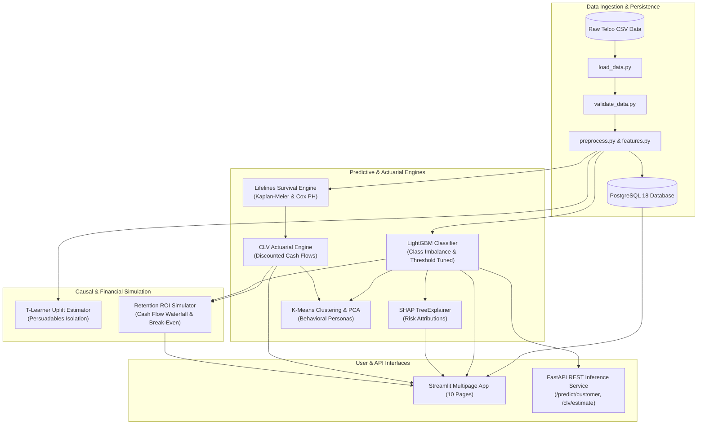

# System Architecture: Customer Lifetime Value & Churn Intelligence System

## Architectural Design Principles

1. **Separation of Concerns:** 
   Raw data ingestion, feature transformation, statistical modeling, persistence, and presentation are strictly decoupled into independent modules under `src/`.
2. **Leak-Free Featurization Boundary:** 
   StandardScaler and OneHotEncoder are fitted exclusively on training splits after stratified partitioning. Held-out validation and test sets remain completely unseen.
3. **Enterprise PostgreSQL Persistence:**
   Full PostgreSQL schema support with parameterized SQLAlchemy transactions. Decouples raw operational records from model-generated inferences, with real-time connection telemetry across UI banners.
4. **Distinction Between Prediction and Causality:**
   Predictive churn flags ($P(\text{Churn} \mid X)$) are treated strictly as correlations. Causal treatment response (uplift $\tau(X)$) is modeled separately via Meta-Learners and clearly distinguished from observational data.
